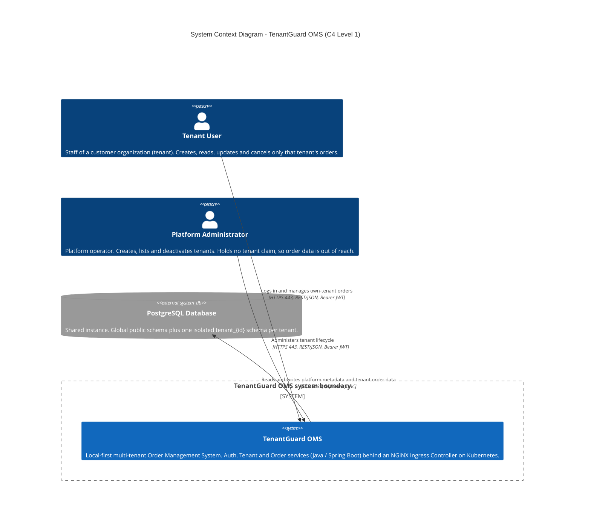
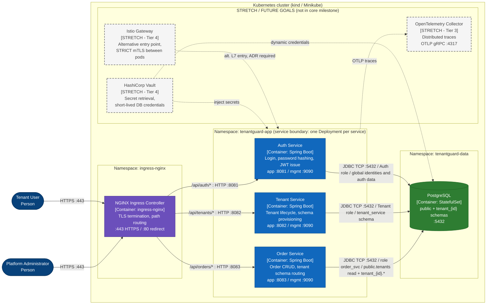
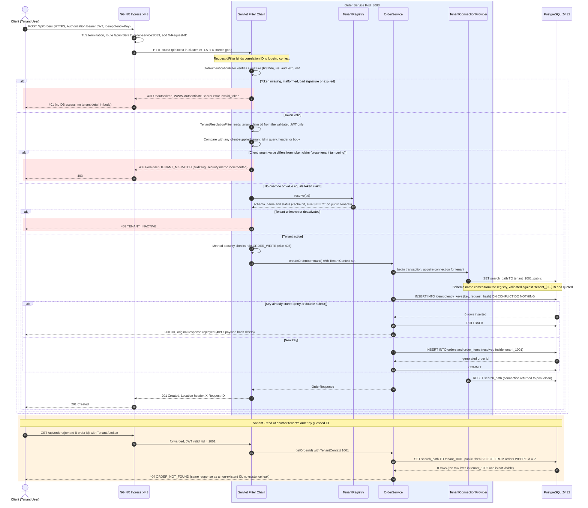
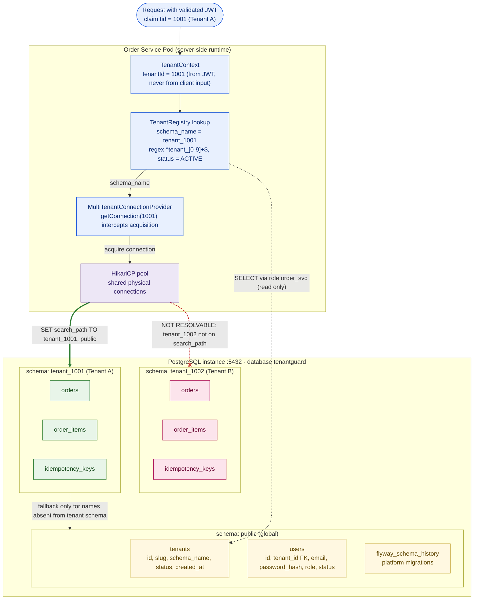
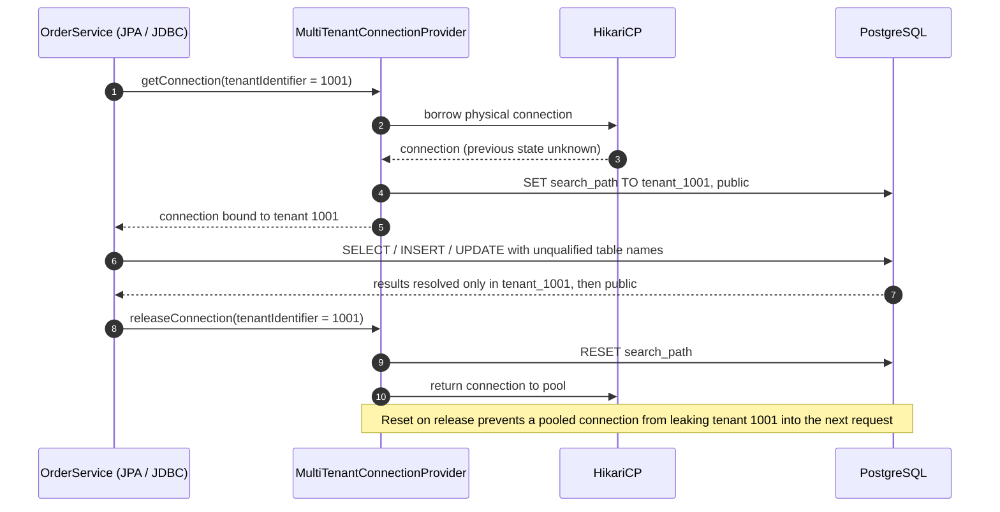
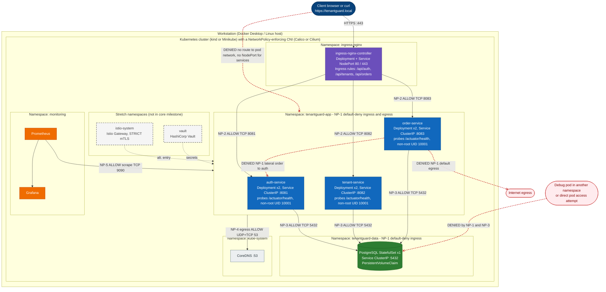
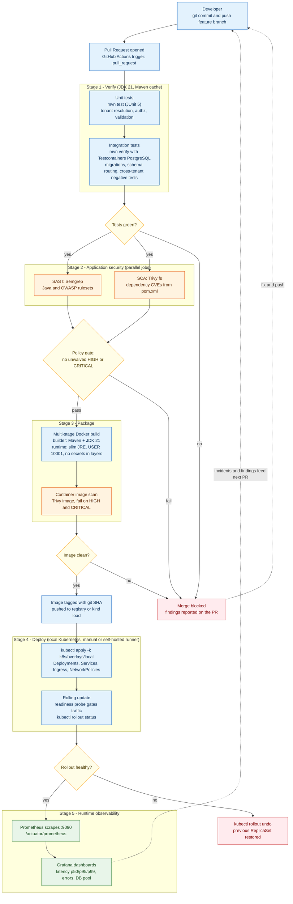
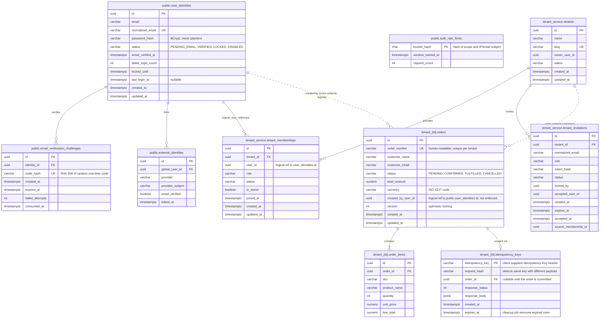

# TenantGuard OMS - Mermaid Diagrams

> **Status: historical target-design sketches, not a description of the current deployment.** This document contains earlier examples of tenant-scoped JWT claims, a public runtime registry, Order Service, and tenant-schema routing. Those examples are not implemented and must not override the accepted global-identity contract. See [the architecture-freeze diagrams](./architecture-freeze-diagrams.md) for the canonical target boundaries and [the consistency report](./ARCHITECTURE-CONSISTENCY-REPORT.md) for verified implementation status.

## 1. System Context (C4 Level 1)



## 2. Container and Service Architecture (C4 Level 2)



## 3. Request-Flow Sequence (Order Creation)



## 3a. Public Registration and Global Identity Verification

Registration is global and independent of tenant membership. The pending identity stores its password hash; the linked challenge stores only the one-time code hash and expiry/attempt metadata. Verification changes the identity state and consumes the challenge atomically.

```mermaid
sequenceDiagram
  autonumber
  actor U as Registrant
  participant AUTH as Auth Service
  participant DB as Auth-owned PostgreSQL tables
  participant SMTP as Configured SMTP server

  U->>AUTH: POST /api/auth/register with email/password only
  AUTH->>DB: Store PENDING_EMAIL global identity with password hash
  AUTH->>DB: Store linked challenge with SHA-256 code hash and expiry
  AUTH->>SMTP: Send code to normalized email
  AUTH-->>U: 202 generic response
  U->>AUTH: POST /api/auth/verify-email with email/code
  AUTH->>DB: Enforce rate limit; validate expiry and single use
  AUTH->>DB: Mark global identity verified and delete challenge atomically
  AUTH-->>U: 204 No Content
```

Registration and verification share database-backed fixed-window rate limits. The code is cryptographically random, expires after 15 minutes, is stored hashed, and is invalidated on use or after five failed attempts. Local Compose uses Mailpit as an SMTP capture service; production supplies a real SMTP configuration.

## 4. Multi-Tenant Data Isolation



## 4b. Connection Acquisition and Release



## 5. Deployment and Network Architecture



## 6. CI/CD and Operations Flow




## 7. Entity-Relationship Diagram (ERD)


