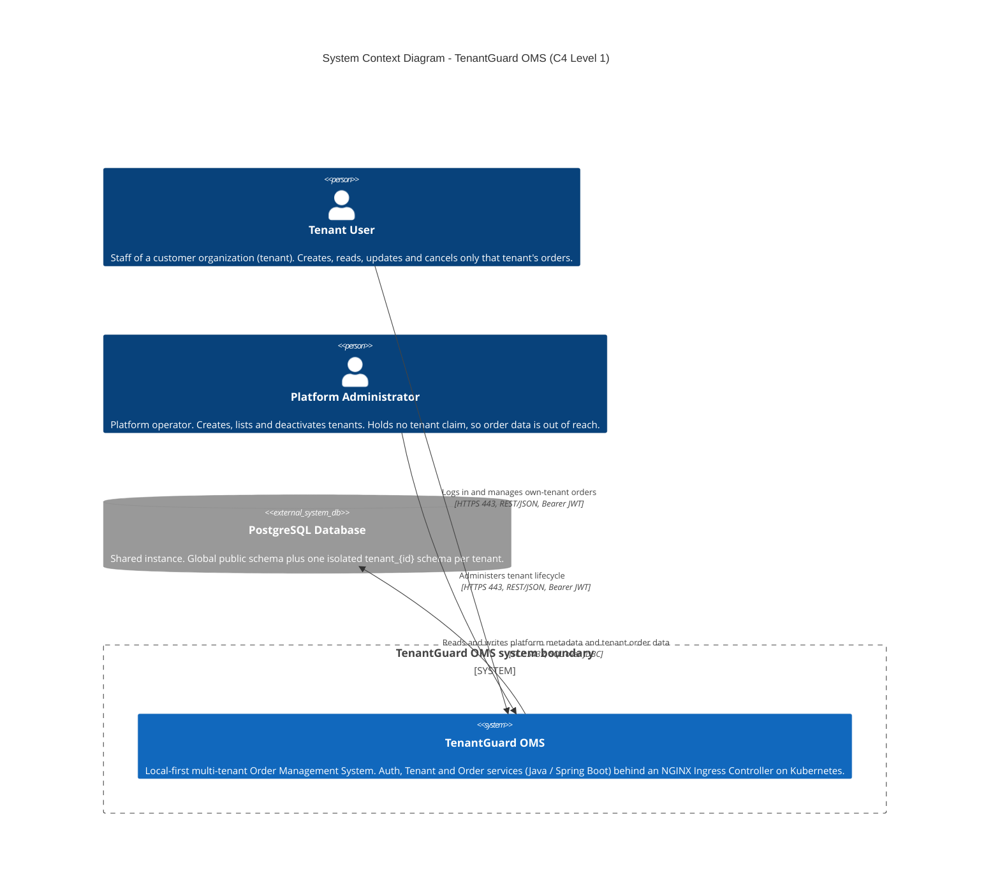
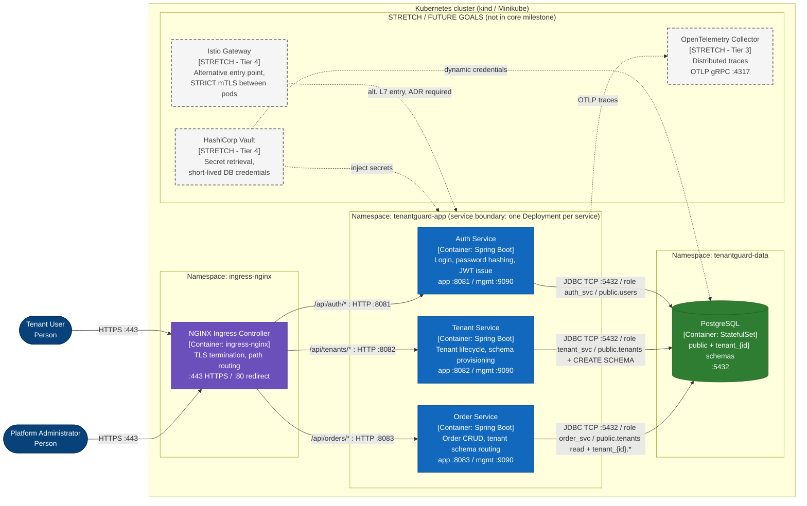
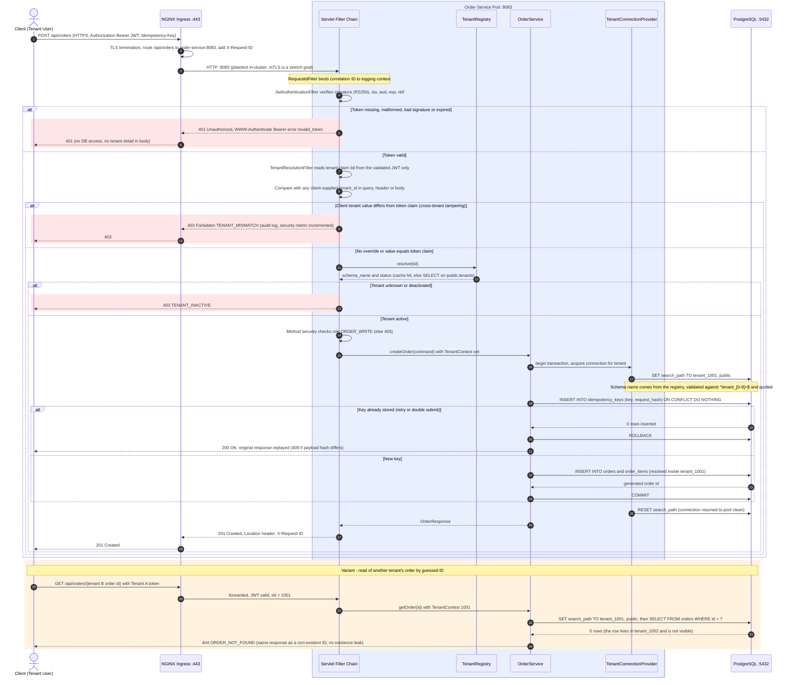
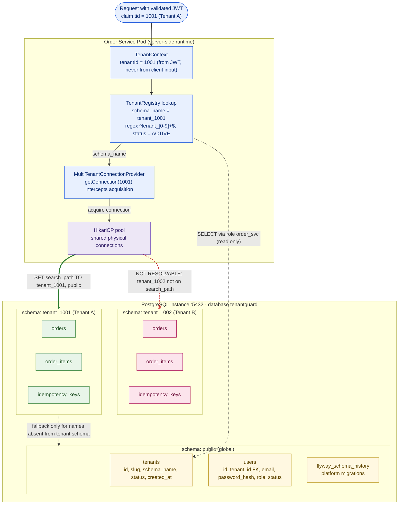
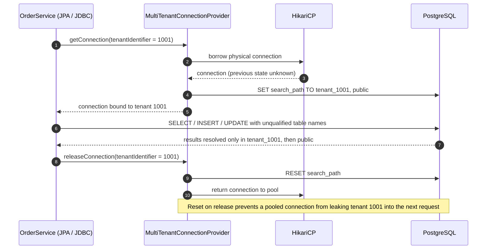
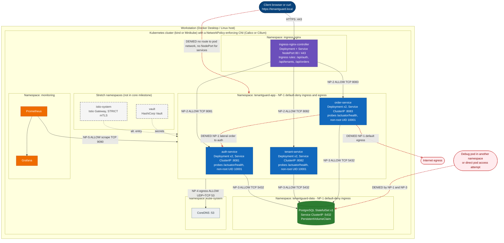
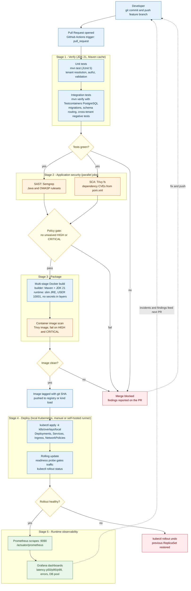
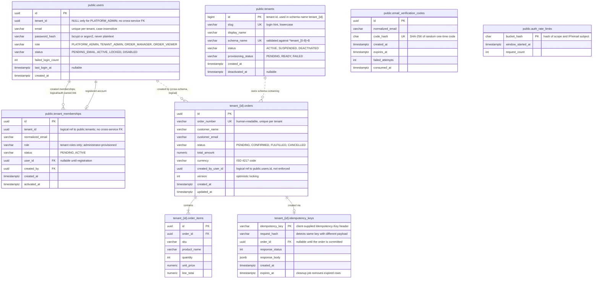

# TenantGuard OMS - Mermaid Diagrams

## 1. System Context (C4 Level 1)



## 2. Container and Service Architecture (C4 Level 2)



## 3. Request-Flow Sequence (Order Creation)



## 3a. Public Registration and Verified Tenant Membership

Tenant membership is provisioned by an authenticated tenant administrator in Auth Service. Tenant ID and role used by public registration come exclusively from the pending membership record. The registration request accepts only email and password; its account remains unable to authenticate until the email code is verified.

```mermaid
sequenceDiagram
  autonumber
  actor A as Tenant administrator
  actor U as Registrant
  participant AUTH as Auth Service
  participant DB as Auth-owned PostgreSQL tables
  participant SMTP as Configured SMTP server

  A->>AUTH: POST /api/auth/memberships with tenant JWT
  AUTH->>AUTH: Require TENANT_ADMIN and matching JWT tid
  AUTH->>DB: Store pending tenant/email/role membership
  U->>AUTH: POST /api/auth/register with email/password only
  AUTH->>DB: Lock matching memberships; create PENDING_EMAIL account(s)
  AUTH->>DB: Store SHA-256 hash of random code, expiry, attempt count
  AUTH->>SMTP: Send code to normalized email
  AUTH-->>U: 202 generic response (no membership disclosure)
  U->>AUTH: POST /api/auth/verify-email with email/code/chosen password
  AUTH->>DB: Enforce rate limit; validate expiry and single use
  AUTH->>DB: Atomically activate associated accounts and memberships
  AUTH-->>U: 204 No Content
```

Registration and verification share database-backed fixed-window rate limits. The code is cryptographically random, expires after 15 minutes, is stored hashed, and is invalidated on use or after five failed attempts. Local Compose uses Mailpit as an SMTP capture service; production supplies a real SMTP configuration.

## 4. Multi-Tenant Data Isolation



## 4b. Connection Acquisition and Release



## 5. Deployment and Network Architecture



## 6. CI/CD and Operations Flow




## 7. Entity-Relationship Diagram (ERD)


