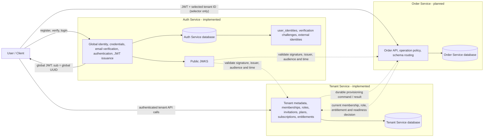
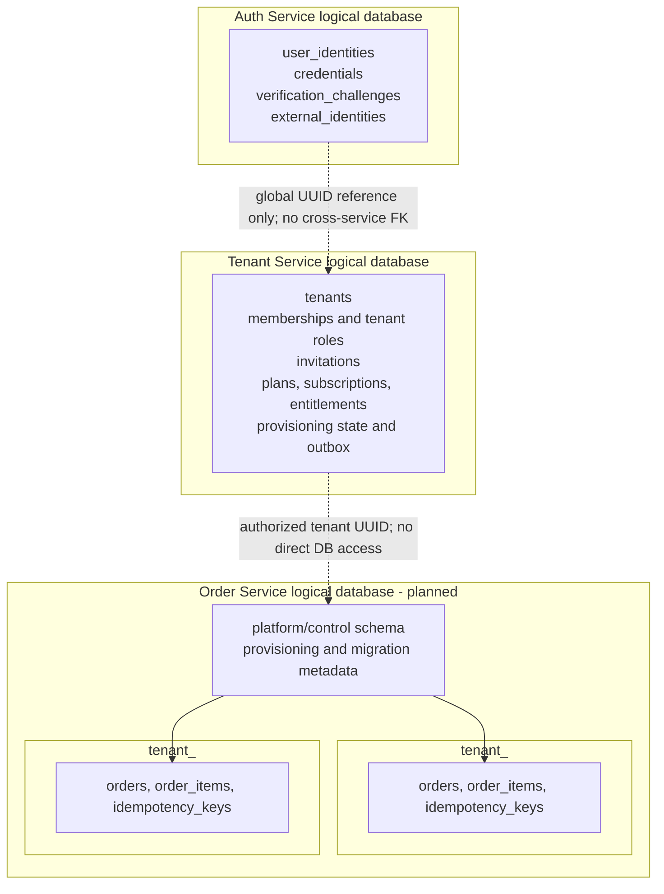

# TenantGuard OMS Architecture Freeze Diagrams

- Status: Accepted target architecture; future components are not claims of current implementation.
- Date: 2026-11-20
- Governing decisions: [ADR-001](../adr/ADR-001-identity-and-authentication-ownership.md), [ADR-002](../adr/ADR-002-tenant-authorization-and-membership.md), [ADR-003](../adr/ADR-003-postgresql-schema-per-tenant-isolation.md), and [ADR-004](../adr/ADR-004-tenant-provisioning-and-lifecycle.md).

Dashed borders and notes indicate planned components or contracts. Auth Service and Tenant Service exist; Order Service, Order database, tenant schema routing, and provisioning are not implemented.

## A. Service ownership and database boundaries



Target database ownership is separate per service. One local PostgreSQL cluster may host these logical databases, but services do not read or write another service's database. Tenant IDs stored by other services are logical UUID references, not cross-database foreign keys.

## B. Authentication and tenant authorization

```mermaid
sequenceDiagram
    actor User
    participant Auth as Auth Service
    participant Tenant as Tenant Service
    participant Order as Order Service (planned)
    participant TDB as Tenant Service DB
    participant ODB as Order Service DB

    User->>Auth: POST /api/auth/register (email, password)
    Auth-->>User: 202 verification accepted
    User->>Auth: POST /api/auth/verify-email (email, code)
    Auth-->>User: 204 verified
    User->>Auth: POST /api/auth/login (email, password only)
    Auth-->>User: RS256 JWT, sub = global user UUID
    User->>Tenant: GET /api/v1/tenants + Bearer JWT
    Tenant->>Tenant: Verify JWT; derive global UUID from sub
    Tenant->>TDB: List active memberships
    TDB-->>Tenant: Zero or more tenants
    Tenant-->>User: Tenant list
    Note over User: Tenant choice is application context, not authentication.
    User->>Order: Order request + Bearer JWT + selected tenant ID
    Order->>Order: Verify JWT; treat tenant ID as untrusted selector
    Order->>Tenant: Authenticated service call + end-user JWT (tenant, action)
    Tenant->>TDB: Check tenant status, current membership/role, entitlement, provisioning state
    TDB-->>Tenant: Current authorization facts
    Tenant-->>Order: Allow/deny and minimal authorized context
    alt Denied, not READY, or authorization service unavailable
        Order-->>User: Deny; no tenant schema query
    else Allowed and READY
        Order->>ODB: Transaction-local schema selection and tenant-scoped query
        ODB-->>Order: Tenant-scoped result
        Order-->>User: Order response
    end
```

## C. Tenant provisioning sequence

```mermaid
sequenceDiagram
    actor User
    participant Tenant as Tenant Service
    participant TDB as Tenant Service DB
    participant Worker as Tenant outbox dispatcher
    participant Order as Order Service (planned)
    participant ODB as Order Service DB

    User->>Tenant: POST /api/v1/tenants (name, slug, subscriptionPlanCode) + JWT
    Tenant->>Tenant: Validate JWT and derive global user UUID
    Tenant->>TDB: One transaction: tenant PENDING, OWNER membership, subscription, entitlement snapshot, outbox command
    TDB-->>Tenant: Commit
    Tenant-->>User: 201 Created with provisioningState=PENDING
    Worker->>TDB: Claim pending outbox command
    Worker->>Order: Authenticated provisioning request (tenant UUID, version, idempotency key)
    Order->>ODB: Record/lock operation; derive tenant schema from UUID
    Order->>ODB: Create schema idempotently and run tenant migrations
    alt All migrations succeed
        ODB-->>Order: Durable READY result
        Order-->>Worker: Provisioning success
        Worker->>TDB: Complete outbox and set provisioningState=READY
        Tenant-->>User: Subsequent tenant operations are available
    else Temporary or permanent failure
        ODB-->>Order: Preserve migration/error state
        Order-->>Worker: Failure result
        Worker->>TDB: Record attempt; set RETRYING or FAILED
        Note over Tenant,Order: Tenant business operations remain unavailable until READY.
    end
```

## D. Database isolation model



The Order Service selects only the schema derived from the authorized immutable tenant UUID. Schema-per-tenant is logical data separation; it is not independent compute, connection capacity, or performance isolation. See [ADR-003](../adr/ADR-003-postgresql-schema-per-tenant-isolation.md) for connection, migration, and resource safeguards.
