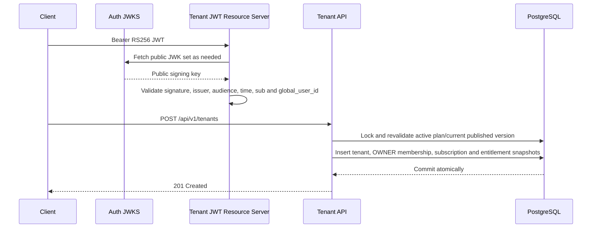
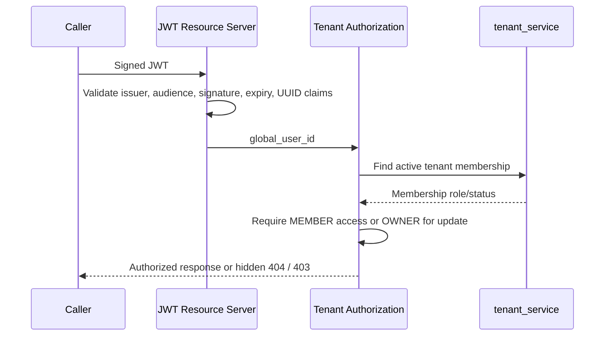
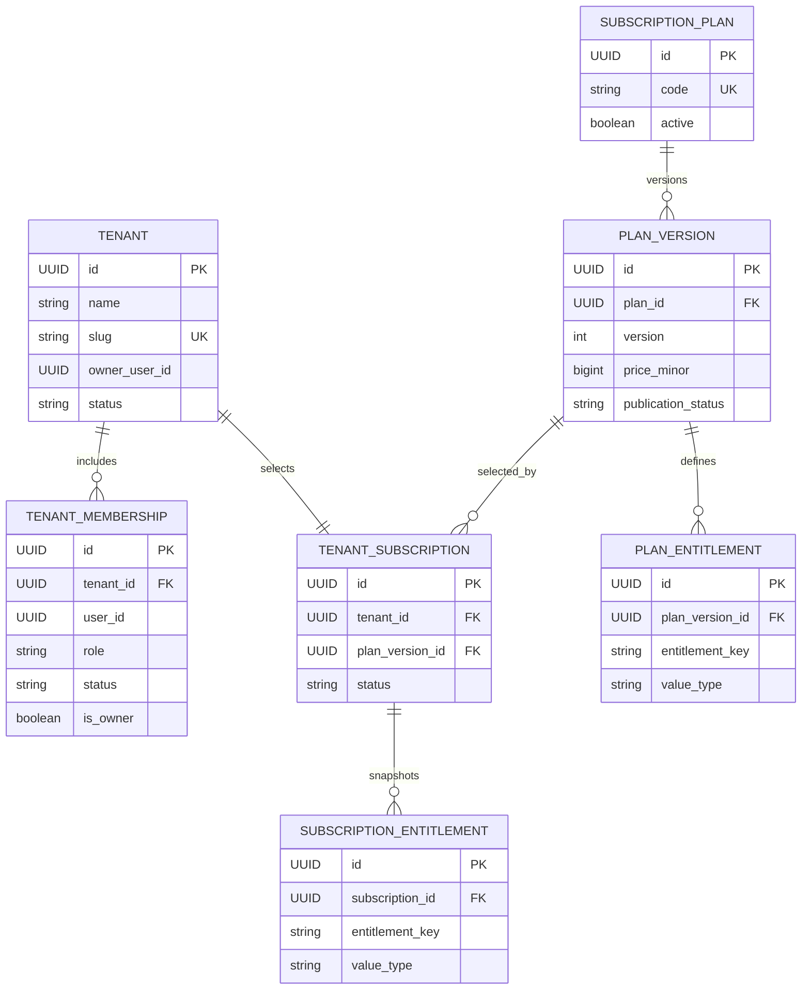
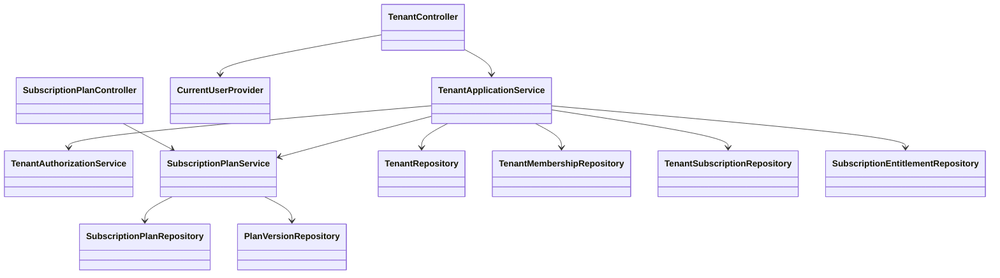
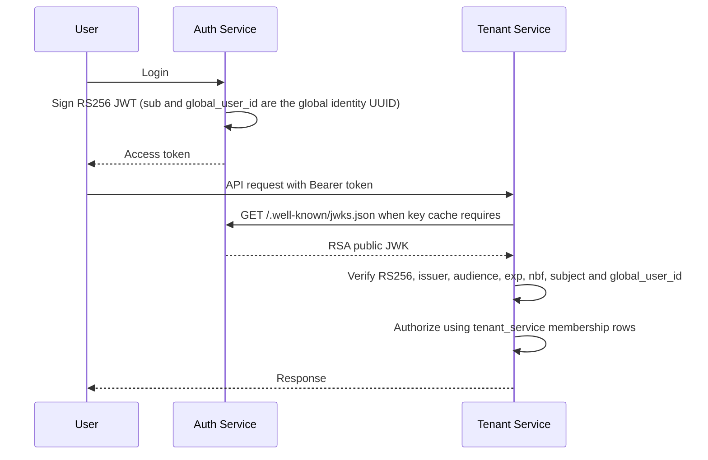

# Tenant Service Architecture

## Ownership and trust boundary

Auth Service owns global identities and credentials. It issues RS256 JWTs with the global identity UUID in both `sub` and `global_user_id`, and no tenant claims. Tenant Service trusts only JWTs validated against Auth's JWKS, configured issuer, audience, temporal claims, and UUID subject. Tenant membership and authorization are resolved only from the `tenant_service` schema.

Tenant Service owns all tenant, membership, invitation, subscription, and entitlement tables under `tenant_service`. The legacy `public.tenants` registry is retained as `tenant_service.legacy_tenant_registry`. Auth no longer reads tenant data, and there are no foreign keys from Tenant Service to Auth tables. A separate migration role has limited read access to selected legacy Auth tables for the one-time transfer; the Tenant Service runtime role does not.

## Tenant creation



## Subscription selection

```mermaid
sequenceDiagram
    participant Client
    participant API as Tenant Service
    participant DB as tenant_service schema
    Client->>API: GET /api/v1/subscription-plans with Auth JWT
    API->>DB: Read active plans/current published versions/typed entitlements
    DB-->>API: Catalogue rows
    API-->>Client: Plan DTOs generated from database
    Client->>API: POST /api/v1/tenants with plan code
    API->>DB: Lock active plan and current published version
    API->>DB: Persist selected version and entitlement snapshot
    Note over API,DB: Zero-price plan is ACTIVE; other plans are PENDING_PAYMENT
```

## Membership authorization



## ERD



## Class responsibilities



## JWT authentication flow


