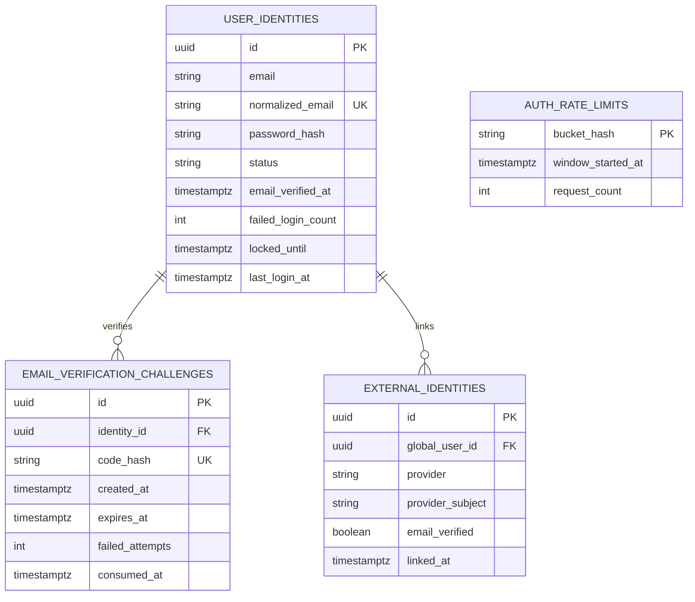

# Auth Service

The Authentication Service (`auth-service`) manages global identities, email-verified registration, credential verification, external identity mapping (Google OIDC), and short-lived RS256 JWT issuance. Login is independent of tenant creation and membership; Tenant Service owns tenant onboarding and membership authorization.

It is implemented with **Spring Boot 4 / Spring Security 7 on Java 27**, aligning with the documented microservice boundaries and least-privilege PostgreSQL database isolation.

---

## 1. Architectural Role and Service Boundaries

- **Database Ownership**:
  - `auth-service` owns global `public.user_identities`, verification challenges, rate-limit buckets, and external identity mappings.
  - `tenant-service` owns tenants, memberships, invitations, and subscriptions in the `tenant_service` schema. Auth does not read or write tenant tables.
  - Legacy account, membership, invitation, and tenant-registry records are retained or archived by forward-only migrations; they are not runtime compatibility dependencies.
- **Zero Lateral Coupling & Stateless Verification**:
  - Downstream services validate tokens with Auth's published public JWK set and do not query Auth's database.
  - Access tokens are signed using **RS256** with an RSA 2048-bit private key.
  - Public keys are published in RFC 7517 format at `/.well-known/jwks.json`.
  - Login JWTs set `sub` to the verified global `user_identities.id`. The compatibility `global_user_id` claim contains the same UUID. Global login tokens do not contain tenant IDs or tenant roles; Tenant Service derives membership and permissions from its own records.
- **Multi-Tenant Identity Scoping**:
  - `public.user_identities` stores globally unique email identities, verification state, and global login lockout state. A verified identity can authenticate without a tenant membership.
  - Tenant roles and membership status are stored and enforced only by Tenant Service; Auth JWTs do not contain tenant roles or tenant IDs.

---

## 2. Authentication Strategies & Design Patterns

### The Strategy Design Pattern
Compatible credential-verification workflows use the Strategy Pattern:
- **`AuthenticationStrategy`**: Domain interface defining `getMethod()` and `authenticate(AuthenticationRequest)`.
- **`PasswordAuthenticationStrategy`**: Concrete strategy that translates requests into Spring Security's `PasswordAuthenticationToken` and delegates to `AuthenticationManager`.
- **`AuthenticationStrategyResolver`**: Spring component collecting all `AuthenticationStrategy` beans via dependency injection, indexing them in an immutable map, and rejecting duplicate strategies at application startup.
- **Decoupling**: Strategy selection is isolated from token issuance (`AccessTokenService`) and account management (`RegistrationService`). Adding future compatible strategies (such as machine-to-machine API keys) requires only a new strategy bean without modifying existing callers.

### Why Google OIDC is NOT a Synchronous Strategy
Google OAuth2 / OpenID Connect is an asynchronous, browser-redirect authorization code flow. Forcing OIDC into a synchronous password-style interface would introduce artificial blocking or pseudo-credentials. Instead, Spring Security's native `OAuth2LoginAuthenticationFilter` handles the handshake, while `GoogleOidcAuthenticationHandler` and `ExternalIdentityService` manage user account resolution and token issuance.

### Strict External Identity Rules
- Accounts are **never** automatically linked to Google identities solely by matching email addresses.
- External identities are mapped by immutable `(provider, provider_subject)` to a global identity in `public.external_identities`.
- Users must explicitly link their external identity to their authenticated account.
- Linking is idempotent: re-linking the same provider subject to the same global identity succeeds cleanly. Attempting to link a subject already claimed by another identity returns `409 Conflict`.

---

## 3. Account Security Policies

- **Email Normalization**: Raw email addresses are trimmed and converted to lowercase using Java `Locale.ROOT`. No provider-specific dot or plus-address rewriting is applied.
- **Password Security**:
  - BCrypt hashing with salt. Plaintext passwords are never persisted or logged.
  - Password length: minimum 12 characters, maximum 72 bytes (BCrypt truncation threshold).
- **Account Lockout**:
  - Ten consecutive failed login attempts against a global identity trigger an automatic 15-minute lockout (`user_identities.locked_until`).
  - Lockout state is cleared automatically upon expiration or on successful login.
- **Anti-Enumeration Responses**:
  - Invalid credentials, locked identities, and disabled identities return a uniform `401 Unauthorized` with a generic message.

## 4. PostgreSQL schema ownership

Auth and Tenant Service use separate PostgreSQL schemas and logins. Tenant Service migrations use the dedicated `tenant_service_migrator` role; the application runs as the restricted `tenant_service` role. The migrator receives temporary access to selected legacy Auth tables for the forward-only data transfer. Tenant V2 archives the old `public.tenants` registry and membership/invitation rows; Tenant V3 verifies and removes the transferred membership/invitation source rows. Auth V10 then removes the obsolete Auth-owned tables.

Auth Service Flyway history remains in the dedicated `auth_service` schema. The Compose bootstrap is idempotent and preserves existing PostgreSQL volumes. Before cleaning up any archived or unresolved data, review `auth_service.legacy_identity_migration_issues`, `auth_service.legacy_identity_migration_accounts`, `auth_service.legacy_external_identity_mappings`, `auth_service.tenant_data_transfer_status`, `tenant_service.legacy_auth_memberships`, and `tenant_service.legacy_auth_invitations`.

Compose requires a root `.env` file containing the database passwords and JWT keys. Compose reads `.env` for interpolation but passes only explicitly mapped values into each container. Set separate `TENANT_DB_PASSWORD` and `TENANT_MIGRATION_PASSWORD` values; the application and migration roles should not share credentials. Never put credentials or signing keys in tracked files.

`POSTGRES_USER` defaults to `auth_service` for compatibility with the current local database setup. For an existing `pgdata` volume, `POSTGRES_PASSWORD` must match the administrator password with which that volume was initialized; changing the environment variable does not change a persisted PostgreSQL role password. The bootstrap creates/updates the separate `DB_USERNAME` role and transfers existing Auth Service table ownership to it.

Create a local environment file, set database passwords, and generate a fresh JWT key pair in PowerShell 7 (the key loader expects Base64-encoded DER bytes, not PEM text):

```powershell
Copy-Item .env.example .env
notepad .env

$rsa = [System.Security.Cryptography.RSA]::Create(2048)
$privateKey = [Convert]::ToBase64String($rsa.ExportPkcs8PrivateKey())
$publicKey = [Convert]::ToBase64String($rsa.ExportSubjectPublicKeyInfo())
$rsa.Dispose()
$envLines = Get-Content .env
$envLines = $envLines | ForEach-Object {
    if ($_ -match '^AUTH_JWT_PRIVATE_KEY_BASE64=') { "AUTH_JWT_PRIVATE_KEY_BASE64=$privateKey" }
    elseif ($_ -match '^AUTH_JWT_PUBLIC_KEY_BASE64=') { "AUTH_JWT_PUBLIC_KEY_BASE64=$publicKey" }
    else { $_ }
}
Set-Content -Path .env -Value $envLines -Encoding utf8NoBOM
```

In `.env`, set distinct strong values for `POSTGRES_PASSWORD` and `DB_PASSWORD`. When reusing an existing PostgreSQL volume, `POSTGRES_PASSWORD` must be the current password for `POSTGRES_USER`; changing it in `.env` does not update the persisted PostgreSQL role. The checked-in example contains only non-secret local defaults; change the issuer, audience, key ID, and token TTL only if your local setup needs different values. Keep `.env` private and do not send its contents to logs or source control. The RSA private key is PKCS#8 DER before Base64 encoding; the public key is X.509 SubjectPublicKeyInfo DER before Base64 encoding. The Java configuration validates a minimum 2048-bit RSA modulus and matching public/private moduli, and token issuance explicitly uses RS256.

---

## 4a. Public registration and verified identities

The public registration request contains only an email and password. Registration creates a `PENDING_EMAIL` row in `public.user_identities` with the password hash and a linked row in `public.email_verification_challenges` with only the code hash, expiry, attempt count, and consumption timestamp. Plaintext passwords and codes are not persisted. A challenge cannot exist without its global identity.

Verification codes contain 256 bits of randomness, are stored as SHA-256 hashes, expire after 15 minutes, and are single-use with a five-attempt limit. `consumed_at` and `expires_at` define challenge state; there is no duplicated status column. A partial unique index allows only one unconsumed challenge per identity. Re-registering a pending identity replaces its password hash and challenge. Re-registering an already verified identity does not change credentials or issue another code. Expired challenges are independently rejected on every verification request and removed by scheduled cleanup. Registration and verification use database-backed fixed-window limits: five requests/hour per IP and normalized email for registration, and ten/hour for verification.

Email verification marks the pending global identity as verified and deletes the one-time challenge in the same transaction. It never creates a tenant or membership. After verification, the user can log in with email and password alone and receive a global JWT. Tenant Service then returns the user's membership list, which may be empty; the user can create a tenant there without Auth selecting or creating one.

The database transaction that stores a challenge commits before synchronous SMTP delivery, so database locks are not held open while contacting the mail server. SMTP and PostgreSQL are not atomic: delivery failure is reported while the pending challenge remains; repeating registration rotates the code and retries. Local Compose runs Mailpit as an SMTP capture service at `http://localhost:8025`; production must configure a real SMTP host, credentials, sender, and TLS policy through deployment secrets.

The migration files are an upgrade history, not separate databases. Keep applied versioned migrations unchanged; use a new version for future schema changes.

| Auth version | Purpose |
| --- | --- |
| V1-V2 | Create initial authentication tables and external identity links. |
| V3-V6 | Evolve legacy membership and email-verification flows into self-service identity registration and one-time challenges. |
| V7 | Add global identity login and lockout state. |
| V8 | Backfill unambiguous legacy credentials; record conflicts for reconciliation. |
| V9 | Move pending credentials to global identities, normalize challenges, and record/grant the staged Tenant transfer. |
| V10 | Require completed transfer when legacy rows existed, archive unresolved records, and remove obsolete Auth-owned tenant/account tables. |

Auth V10 also revokes the migration role's temporary access to the Auth transfer marker. Unresolved credential hashes remain in the restricted `auth_service.legacy_identity_migration_accounts` audit table; unresolved external links are retained in `auth_service.legacy_external_identity_mappings`. The issue ledger remains for reconciliation.

### Staged upgrade for databases with existing tenant rows

Do not deploy Auth V10 before Tenant V3 has completed. For an existing database with legacy membership or invitation rows:

1. Deploy Auth with Flyway limited to version 9 (`spring.flyway.target=9`). Confirm Auth is healthy.
2. Run Tenant migrations through V3. Tenant V2 archives the legacy rows; Tenant V3 checks that every source row is archived and then deletes the transferred source rows.
3. Remove the Flyway target and restart Auth so V10 can verify the source tables are empty and remove them.
4. Recreate `tenant-schema-bootstrap` after Tenant V3. The bootstrap revokes the migrator's temporary `public` schema access once the transfer is complete.

For a fresh, empty database, the complete Auth migration chain can run immediately; V10 permits empty source tables. Do not reset a persistent volume to bypass the staged upgrade.

## 4b. Auth database model and lifecycle



- `user_identities` is the canonical global account and credential store. `normalized_email` is unique. Valid lifecycle states are `PENDING_EMAIL`, `VERIFIED`, `LOCKED`, and `DISABLED`; pending identities have no `email_verified_at`, and all other states require it.
- `email_verification_challenges` references one pending identity. Registration persists the BCrypt password hash on the identity. Challenge rows contain no password, only the one-time code hash and lifecycle metadata.
- `external_identities` maps a unique provider subject to exactly one global identity. No email-based auto-linking is performed.
- `auth_rate_limits` remains necessary: registration and verification consume database-backed fixed-window buckets, and a scheduled task removes old buckets.
- Ten consecutive failed password attempts lock a verified identity for 15 minutes. A successful login resets the counter and clears an elapsed lock. Disabled identities cannot authenticate.
- `auth_service.legacy_identity_migration_issues`, `auth_service.tenant_data_transfer_status`, and the `legacy_*` archive tables are migration/audit data, not runtime authentication sources.

Auth owns no tenant ID, tenant role, tenant membership, or tenant invitation. Tenant Service uses global UUIDs as logical user references and performs all tenant authorization from its own schema.

```mermaid
sequenceDiagram
  actor User as Registrant
  participant Auth as Auth Service
  participant DB as Auth-owned PostgreSQL schema
  participant SMTP as Configured SMTP server
  User->>Auth: POST /api/auth/register (email, password only)
  Auth->>DB: Store password hash, code hash and expiry; invalidate prior challenge
  Auth->>DB: Commit temporary challenge only
  Auth->>SMTP: Send one-time code after commit
  Auth-->>User: 202 generic accepted response
  User->>Auth: POST /api/auth/verify-email (email, code)
  Auth->>DB: Check rate limit, expiry and attempt count
  Auth->>DB: Create verified global identity and delete challenge atomically
  Auth-->>User: 204 No Content
  User->>Auth: POST /api/auth/login (email, password only)
  Auth->>DB: Verify global identity, password, status and lockout
  Auth-->>User: RS256 JWT (sub = global user UUID; no tid or tenant role)
  User->>Auth: Continue to dashboard and request memberships from Tenant Service
```

## 5. HTTP API Contract

### Public Endpoints

#### `POST /api/auth/register`
Publicly starts email verification without requiring a tenant membership. The request has no invitation token, tenant ID, role, or authorization header. New requests store a pending challenge only; repeated requests replace its password hash and code hash and send a fresh code. Existing verified identities and existing active accounts are not modified; the generic response is retained to avoid exposing account state.
```json
{
  "email": "user@example.com",
  "password": "SecurePassword123!"
}
```
**Response `202 Accepted`** (generic response for eligible and ineligible email/account states):
```json
{
  "message": "If this email is eligible, a verification code will be sent."
}
```

#### `POST /api/auth/verify-email`
Publicly verifies the one-time code sent to the email address. A valid code is single-use, expires after 15 minutes, creates a verified global identity, and deletes the temporary challenge atomically. It does not create a tenant account or activate any membership. Returns `204 No Content`; invalid, expired, or exhausted codes return `400 Bad Request`.
```json
{
  "email": "user@example.com",
  "code": "<64-character-hex-code-from-email>"
}
```

#### `POST /api/auth/login`
Authenticates a verified global identity using only email and password. Tenant membership, tenant status, and a client-supplied tenant ID are not used.
```json
{
  "email": "user@example.com",
  "password": "SecurePassword123!"
}
```

**Response `200 OK`**:
```json
{
  "accessToken": "eyJhbGciOiJSUzI1NiIs...",
  "tokenType": "Bearer",
  "expiresIn": 600
}
```
The JWT `sub` and compatibility `global_user_id` claim are the global identity UUID. Login tokens do not contain `tid` or tenant-role claims.

#### `GET /.well-known/jwks.json`
Publishes the RSA public verification key set in RFC 7517 format for downstream services.

---

### Authenticated Endpoints (Requires Bearer JWT)

Membership provisioning, invitations, and tenant authorization are Tenant Service responsibilities. Auth exposes no membership endpoint and does not issue tenant-role or tenant-ID claims.

#### `POST /api/auth/external-identities/google`
Explicitly binds the authenticated user account to a verified Google subject identifier.
```json
{
  "providerSubject": "google-sub-1029384756",
  "emailVerified": true
}
```
**Statuses**: `201 Created`, `200 OK` (idempotent), `409 Conflict` (already claimed by another account).

---

## 6. Environment Configuration

| Variable | Default | Purpose |
|---|---|---|
| `SERVER_PORT` | `8081` | Service HTTP port |
| `DATABASE_URL` | `jdbc:postgresql://localhost:5432/tenantguard` | PostgreSQL JDBC URL |
| `POSTGRES_USER` | `auth_service` (Compose) | PostgreSQL administrator login used by the bootstrap |
| `POSTGRES_PASSWORD` | required | PostgreSQL administrator password |
| `DB_USERNAME` | `auth_service_app` (Compose), `auth_service` (standalone) | Auth Service database login |
| `DB_PASSWORD` | required in Compose | Auth Service database password |
| `AUTH_JWT_ISSUER` | `http://localhost:8081` | JWT `iss` claim |
| `AUTH_JWT_AUDIENCE` | `tenantguard-api` | JWT `aud` claim |
| `AUTH_JWT_ACCESS_TOKEN_TTL` | `PT10M` | Token lifetime (default 10 minutes) |
| `AUTH_JWT_KEY_ID` | `tenantguard-local` | JWS Header `kid` |
| `AUTH_JWT_PRIVATE_KEY_BASE64` | required | Base64-encoded PKCS#8 DER private key (min 2048-bit) |
| `AUTH_JWT_PUBLIC_KEY_BASE64` | required | Base64-encoded X.509 DER public key (min 2048-bit) |
| `MAIL_HOST` | `mailpit` in Compose | SMTP server hostname |
| `MAIL_PORT` | `1025` in Compose | SMTP server port |
| `MAIL_USERNAME` / `MAIL_PASSWORD` | empty for local Mailpit | SMTP credentials; use deployment secrets in production |
| `MAIL_SMTP_AUTH` | `false` in Compose | Enable SMTP authentication |
| `MAIL_SMTP_STARTTLS` | `false` in Compose | Enable SMTP STARTTLS; configure for the production provider |
| `MAIL_FROM` | `no-reply@tenantguard.local` | Verification sender address |

---

## 7. Local Development & Testing

### Running Tests
Execute the automated test suite from the repository root:
```powershell
.\services\auth-service\mvnw.cmd -f .\services\auth-service\pom.xml test
```
The test suite includes:
- `AuthenticationStrategyResolverTests`: Strategy registration and duplicate rejection.
- `PasswordAuthenticationProviderTests`: BCrypt verification, lockout counter, and account status checks.
- `JwtTokenTests`: RS256 token issuance, claims verification, and signature tampering rejection.
- `ExternalIdentityServiceTests`: Google subject mapping, conflict prevention, idempotent re-linking, and anti-email-auto-linking verification.
- `RegistrationServiceTests` and `EmailVerificationServiceTests`: registration rate limiting, pending global identities, single-use verification, and invalid/expired challenge handling.
- `AuthServiceApplicationTests`: End-to-end Testcontainers integration tests (automatically skipped if Docker daemon is not active).

### Running with Docker Compose
From the repository root, copy `.env.example` to `.env`, set both database passwords, and provide the generated RSA keys as described above. Then validate and start the stack:
```bash
docker compose config --quiet
docker compose up --build
```

In another terminal, inspect status and follow each service's startup logs (press Ctrl+C to stop following a log):
```bash
docker compose ps
docker compose logs -f postgres
docker compose logs -f tenant-schema-bootstrap
docker compose logs -f auth-service
docker compose logs -f mailpit
```

The local bootstrap creates service schemas and restricted database roles; Tenant Service owns tenant creation and membership. Users can request email verification without a membership, log in, and create a tenant through Tenant Service. View captured local verification mail at `http://localhost:8025`. Check the health and JWKS endpoints after Auth Service starts:
```bash
curl http://localhost:8081/actuator/health
curl http://localhost:8081/.well-known/jwks.json
```

`tenant-service` waits for Auth Service health before applying its schema migration and importing eligible legacy membership and invitation data. The migration role is separate from the Tenant Service application role. Do not remove archived records or unresolved migration entries until the transfer has been reviewed.

Verification challenge and identity writes commit before SMTP delivery begins, so no database row locks are held while waiting for the mail server. SMTP and PostgreSQL cannot commit atomically: if delivery fails, the API reports an error while the pending identity and hashed challenge remain. Submitting registration again rotates the pending challenge and retries email delivery. Expired and consumed challenge records are removed by a scheduled cleanup task.

### Deploying to Kubernetes
Apply the Kubernetes manifests from `k8s/base/auth-service`:
```bash
kubectl apply -k k8s/base/auth-service
```
This deploys 2 replicas under UID `10001` in the `tenantguard-app` namespace with NGINX Ingress rules, liveness/readiness probes, and resource constraints.
